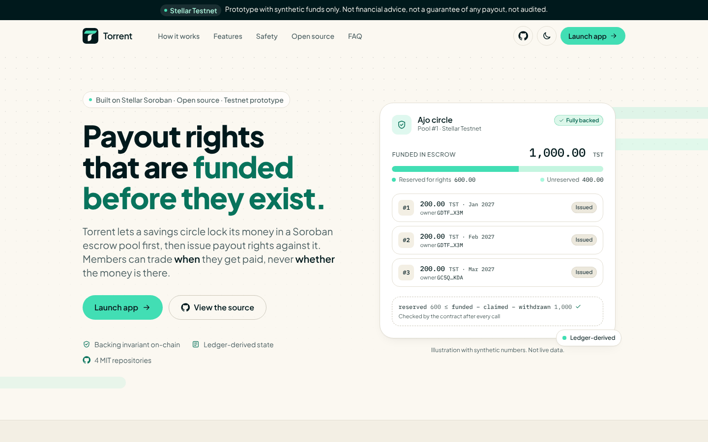
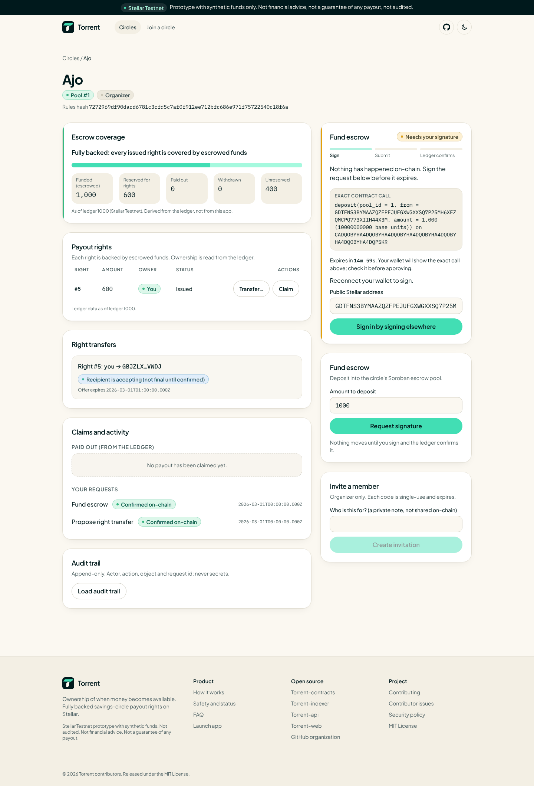
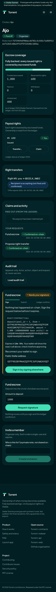
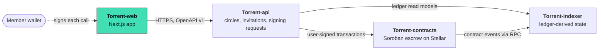

<div align="center">


# Torrent-web

**The Torrent web app: circle dashboard, ledger-derived coverage, payout rights and signing requests.**

[](https://github.com/Torrent998/Torrent-web/actions/workflows/ci.yml)
[](./LICENSE)
[](#status)
[](#status)

Part of **Torrent** — ownership of *when* money becomes available.

</div>

<picture>
  <source media="(prefers-color-scheme: dark)" srcset="./docs/screenshots/landing-hero-1440-dark.png" />
  
</picture>

## This repository

The landing page and the web app in one Next.js codebase:

- **Landing page** (`/`): value proposition, how it works, features, trust and safety, architecture and FAQ.
  The hero illustration is animated, clearly labelled as synthetic, and static under `prefers-reduced-motion`.
- **App** (`/circles`, `/circles/[id]`, `/invitations`): wallet-signature sign-in, circles, ledger-derived escrow
  coverage, payout rights, transfer proposals and recipient approval, claims, invitations, claim history and the
  organizer audit trail.
- **Signing panel**: every request shows the exact contract call, an expiry, and an honest lifecycle
  (`Sign -> Submit -> Ledger confirms`). Nothing is shown as settled until the indexer observes it on the ledger.

Dark and light themes, responsive down to 360 px, keyboard and screen-reader friendly. The app never asks for,
receives or stores a secret key.

| Circle (desktop) | Circle (phone, dark) |
|---|---|
|  |  |

All screenshots are in [docs/screenshots/](./docs/screenshots/) (1440 px and 390 px, light and dark). They were taken
from a production build with Playwright. App screens are rendered from the **real recorded torrent-api responses** in
[`fixtures/api-examples.v1.json`](./fixtures/api-examples.v1.json) served by a local route mock; only the signing
request's expiry was moved forward so its live state is visible. No live network or chain was involved.

## Quickstart

Requires Node.js 22.12 or newer.

```bash
git clone https://github.com/Torrent998/Torrent-web && cd Torrent-web
npm ci
npm run check                 # typecheck + eslint + vitest
npm run build                 # production build
cp .env.example .env.local    # NEXT_PUBLIC_API_BASE_URL -> a running torrent-api
npm run dev                   # http://localhost:3000
```

The landing page works on its own. The app needs a running [Torrent-api](https://github.com/Torrent998/Torrent-api)
(which needs [Torrent-indexer](https://github.com/Torrent998/Torrent-indexer) and a deployed
[Torrent-contracts](https://github.com/Torrent998/Torrent-contracts)). Stop with Ctrl-C.

## Status

| Area | State |
|---|---|
| Landing page (hero, how it works, features, safety, architecture, FAQ) | implemented, tested |
| Wallet-signature sign-in (challenge -> sign -> session), `WalletAdapter` interface | implemented |
| Wallet adapters | **Manual** ("sign elsewhere and paste") and a development-only **TEST WALLET** (`NEXT_PUBLIC_ENABLE_TEST_WALLET=1`, loudly labelled, not submittable on a real network). **No browser-wallet adapter yet** |
| Circles, coverage, rights, funding, transfer proposal and approval, claims, invitations, history, audit trail | implemented |
| Honest states: loading, empty, retryable outage, refusal, expired, submitted vs confirmed, reconciling | implemented |
| Tests | 74 (view models, components, page flows, landing sections, wallet adapters, API client) |
| Cross-repo contract | the 21 real recorded torrent-api responses parse with the web schemas; endpoints checked against the mirrored OpenAPI |
| End-to-end against a live API, indexer, Testnet and a real wallet | **never run** (no deployment exists) |
| Security audit / Mainnet | **no** / **no** |

Design record: [docs/adr/0001-web-design.md](./docs/adr/0001-web-design.md).

## What is Torrent?

In a savings circle, members contribute to a shared pot and take turns receiving it. Sometimes a member
needs their payout earlier, or would happily take it later. **Torrent lets members exchange the timing of a
payout, but only for payouts that are already fully funded.**

1. **Create a circle.** An organizer sets the rules; their hash binds the circle to an on-chain pool.
2. **Fund the pool.** Members deposit a supported Stellar asset into a Soroban escrow contract.
3. **Issue payout rights.** Each right has a unique id, owner, amount and maturity. The contract refuses to
   issue a right that is not covered by unreserved escrow.
4. **Transfer or claim.** The owner proposes, the recipient accepts, both sign. At maturity the current owner
   claims exactly once.

The contract enforces one invariant after every call: `reserved <= funded - claimed - withdrawn`.
A payout right never represents a future contribution that has not been paid.

## Architecture

Torrent is four independently tested repositories, each owning one boundary. The contract is the only source of truth for backing, ownership and payout; the indexer reconstructs that truth from the ledger; the API organizes people and signing requests; the web app shows it honestly.



| Repository | Stack | Owns |
|---|---|---|
| [Torrent-contracts](https://github.com/Torrent998/Torrent-contracts) | Rust · Soroban SDK 29 | Escrow pools, fully backed payout rights, member-only transfers and one-time claims. The only writer of financial truth. |
| [Torrent-indexer](https://github.com/Torrent998/Torrent-indexer) | TypeScript · Node 22 · Stellar RPC | Ingests contract events with a durable cursor and rebuilds pools, rights and transfers from the ledger. |
| [Torrent-api](https://github.com/Torrent998/Torrent-api) | TypeScript · NestJS · SQLite | Circles, invitations, wallet sign-in and the signing-request state machine. Holds no keys and no balances. |
| **[Torrent-web](https://github.com/Torrent998/Torrent-web)** (this repo) | TypeScript · Next.js 16 · Tailwind CSS 4 | Landing page and web app: circles, coverage, rights, transfers, claims and signing requests. |

## Project documents

| Document | What it covers |
|---|---|
| [docs/PRD.md](./docs/PRD.md) | Product purpose, users, MVP and non-goals |
| [docs/SRD.md](./docs/SRD.md) | Domain model, state machine, API surface |
| [docs/ARCHITECTURE.md](./docs/ARCHITECTURE.md) | The four repositories and how data flows between them |
| [docs/STELLAR_PROTOCOL.md](./docs/STELLAR_PROTOCOL.md) | Contract specification and invariants |
| [docs/SECURITY.md](./docs/SECURITY.md) | Threat model and go-live restrictions |
| [docs/ROADMAP.md](./docs/ROADMAP.md) | Milestones and quality gates |
| [docs/BRAND.md](./docs/BRAND.md) | Approved logo and interface principles |
| [docs/adr/](./docs/adr/) | Architecture decision records for this repository |
| [AGENTS.md](./AGENTS.md) | Rules for AI coding agents working in this repository |

The shared product documents are mirrored in all four repositories; the canonical copy lives in
[Torrent-api](https://github.com/Torrent998/Torrent-api/tree/main/docs).

## Contributing and Drips Wave

Contributions are welcome. Start with [CONTRIBUTING.md](./CONTRIBUTING.md), then pick a scoped task from
[docs/CONTRIBUTOR_ISSUES.md](./docs/CONTRIBUTOR_ISSUES.md). Each task names its motivation, the files it touches,
acceptance tests and non-goals. Changes that cross a repository boundary go through the versioned fixtures
each repo publishes, so every PR stays reviewable on its own.

Torrent intends to apply to the [Drips Wave](https://docs.drips.network/wave/maintainers/participating-in-a-wave/)
program for Stellar projects. Participation is subject to Drips' review; nothing here implies approval or rewards.
Please follow the [Code of Conduct](./CODE_OF_CONDUCT.md).

## Security

Torrent is an **unaudited prototype for Stellar Testnet**. Do not use it with real funds.
Please report vulnerabilities privately as described in [SECURITY.md](./SECURITY.md); do not open public issues
for them. The threat model is in [docs/SECURITY.md](./docs/SECURITY.md).

## License

[MIT](./LICENSE). The Torrent logo in [`brand/`](./brand/) is the project's approved identity and is shared by all four
repositories; see [brand/README.md](./brand/README.md) for usage rules.
