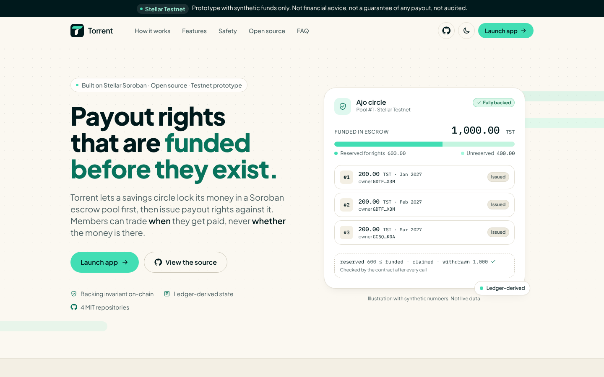
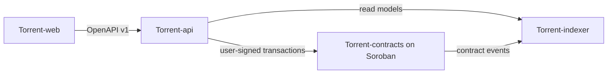

<!--
  Organization profile for github.com/Torrent998.
  To publish: create a public repository named `.github` in the Torrent998 organization and save this file as
  `profile/README.md`. Images use absolute URLs so they render there.
-->

# Torrent

**Ownership of *when* money becomes available.**

Fully backed savings-circle payout rights on Stellar. Open source, built on Soroban.

[Web app](https://github.com/Torrent998/Torrent-web) · [Contracts](https://github.com/Torrent998/Torrent-contracts) · [Indexer](https://github.com/Torrent998/Torrent-indexer) · [API](https://github.com/Torrent998/Torrent-api)

---

In a savings circle, members contribute to a shared pot and take turns receiving it. Torrent lets members trade
**when** they get paid, never **whether** the money is there: payout rights are issued only against funds already
locked in a Soroban escrow contract, and the contract checks `reserved <= funded - claimed - withdrawn` after every call.

<picture>
  <source media="(prefers-color-scheme: dark)" srcset="https://raw.githubusercontent.com/Torrent998/Torrent-web/main/docs/screenshots/landing-hero-1440-dark.png" />
  
</picture>

## Repositories

| | Repository | What it owns |
|---|---|---|
| 🦀 | [**Torrent-contracts**](https://github.com/Torrent998/Torrent-contracts) | Soroban escrow pools, fully backed payout rights, member-only transfers, one-time claims |
| 🔎 | [**Torrent-indexer**](https://github.com/Torrent998/Torrent-indexer) | Contract event ingestion, ledger-derived state, replay and reconciliation |
| 🧭 | [**Torrent-api**](https://github.com/Torrent998/Torrent-api) | Circles, invitations, wallet sign-in and the signing-request state machine |
| 🖥️ | [**Torrent-web**](https://github.com/Torrent998/Torrent-web) | Landing page and web app: coverage, rights, transfers, claims and signing |

## Status

Torrent is an **open-source prototype for Stellar Testnet** with synthetic funds. All four repositories build and pass
their test suites in CI. The contract has not been deployed to Testnet yet, it has **not been audited**, and there is
no Mainnet version. Transferable payout rights would need legal review before any real use.

## Contributing

Every repository has a `CONTRIBUTING.md` and a list of scoped tasks in `docs/CONTRIBUTOR_ISSUES.md`. Torrent intends
to take part in [Drips Wave](https://docs.drips.network/wave/maintainers/participating-in-a-wave/) for Stellar
projects. Report vulnerabilities privately as described in each repository's `SECURITY.md`.

MIT licensed · Not financial advice · Not a guarantee of any payout
